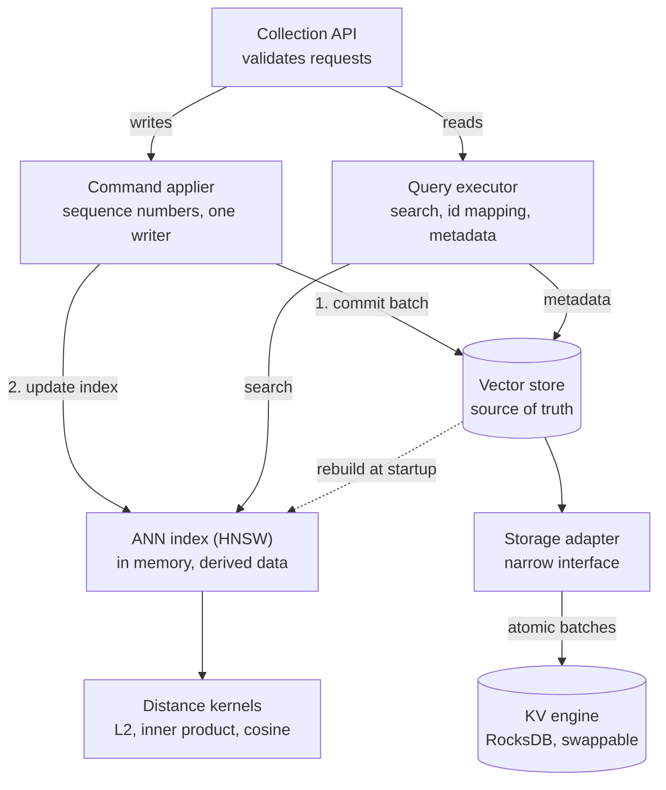

# Single-Node Core — Design

Stack: Java on GraalVM, Micronaut, Lombok, RocksDB.

## Overview

Stage 1 is a single-process vector database: it stores vectors durably in an embedded key-value engine and answers approximate nearest-neighbour (ANN) queries over them. There is no networking, sharding or replication yet. Every later stage (RPC, sharding, Raft replication) wraps this core, so its interfaces must stay stable.

**Goals**

- Create named collections with a fixed dimension and distance metric; insert, get, delete and top-k search vectors with optional metadata.
- Acknowledged writes survive a process crash.
- Keep the storage engine behind one narrow interface so it can be swapped for your own engine later.
- Make every state change a deterministic command, so the same command sequence always produces the same state. Raft will replicate that command log in stage 4.

**Non-goals for this stage**

- Networking, authentication, sharding, replication.
- Rich metadata filtering and hybrid (keyword plus vector) search.
- GPU or SIMD tuning beyond a simple, correct distance kernel.

Detailed design of the public API: [collection-api.md](collection-api.md).

## Architecture



Writes pass through the command applier into the vector store and only then into the index; searches read the index directly. The dashed arrow is the startup path: the index is rebuilt by scanning the vector store.

## Components

The KV engine is the source of truth and the vector index is derived data that can always be rebuilt from it. That one rule keeps recovery simple and lets you swap either part independently.

| Component | Responsibility | Key decision |
| --- | --- | --- |
| Collection API | Validates requests, exposes insert, get, delete, search, create and drop collection | The only surface the RPC layer will call in stage 2 |
| Command applier | Turns each mutation into a command with a sequence number and applies it in order | One apply path for all writes, so Raft can feed it later |
| Catalog | Stores collection name, dimension, metric and index parameters | Persisted in the KV engine, cached in memory |
| Storage adapter | Wraps the KV engine: get, put, delete, atomic batch, range scan, snapshot | Narrow interface, no engine types leak out |
| Vector store | Stores raw float32 vectors and metadata per collection | Fixed-size values keyed by an internal numeric id |
| ANN index (HNSW) | Finds approximate nearest neighbours for a query vector | In memory, rebuilt from the vector store on startup |
| Distance kernels | L2, inner product, cosine over float32 arrays | Pure functions, no allocation in the hot loop |
| Query executor | Runs the index search, fetches metadata, returns top-k with scores | Reads run against a consistent view while writes continue |

**Decisions worth fixing now**

- Each vector gets an internal numeric id (dense, never reused) and a mapping to the caller's external string id. Index graphs work on small integers, not strings.
- Deletes are tombstones in the index and real deletes in the vector store. A background rebuild reclaims tombstoned space.
- Cosine similarity normalizes vectors once at insert time and uses inner product at query time.
- Writes are serialized through one writer. Reads never block on it.

## Data model and key layout

Everything durable lives in six namespaces of the KV engine (column families in RocksDB, named databases in LMDB). Numeric parts of keys are big-endian, so a range scan over one collection returns its vectors in internal-id order.

| Namespace | Key | Value |
| --- | --- | --- |
| `catalog` | collection name | collection id, dimension, metric, index parameters, next internal id |
| `vectors` | collection id + internal id | raw float32 array, `dimension × 4` bytes |
| `metadata` | collection id + internal id | encoded metadata map for that vector |
| `ext_to_int` | collection id + external id | internal id |
| `int_to_ext` | collection id + internal id | external id |
| `system` | fixed names | format version, last applied sequence number |

A collection is immutable in dimension and metric once created. Changing either means creating a new collection and re-inserting.

The ANN index is not stored in the KV engine in this stage. On startup the engine scans `vectors` for each collection and rebuilds the graph. This costs startup time but removes any chance of the index disagreeing with the data. Persisting an index snapshot is an optimization for later and is listed under open questions.

## Write path and query path

A write is durable once the KV batch commits, and the in-memory index is updated only after that. If the process dies between the two steps, startup rebuilds the index from the vector store, so nothing is lost.

**Upsert**

1. Validate that the collection exists and the vector has the right dimension. For cosine collections, normalize the vector.
2. The command applier assigns the next sequence number and builds an `Upsert(collection, external id, vector, metadata)` command.
3. Look up the external id. If it exists, mark its old internal id for deletion and allocate a new internal id; HNSW does not update vectors in place, so an overwrite is a delete plus an insert.
4. Write one atomic batch containing the vector, metadata, both id mappings, the catalog's next internal id and the last applied sequence number. Commit it with a synced write.
5. Insert the new internal id into the HNSW graph and tombstone the old one.
6. Return success to the caller.

**Delete** follows the same steps without the insert: remove the vector, metadata and mappings in one batch, then tombstone the internal id in the index.

**Search**

1. Validate the dimension, `k` and the optional `ef_search` parameter. Normalize the query for cosine.
2. Search the HNSW graph from its entry point, skipping tombstoned nodes, and collect candidates.
3. Map internal ids back to external ids through `int_to_ext`, and fetch metadata if the caller asked for it.
4. Return the top-k results sorted by score.

## Core interfaces

Five interfaces form the seams of the system. They are written here language-neutral; adapt the signatures to your language's idioms. The two that matter most for later stages are `StorageEngine` (swapping your own engine in) and `CommandApplier` (feeding it from a Raft log). The Java form of `CollectionApi` is in [collection-api.md](collection-api.md).

```text
interface StorageEngine {
  get(namespace, key) -> bytes or null
  newBatch() -> WriteBatch          // batch.put(ns, key, value), batch.delete(ns, key)
  commit(batch, sync: bool)         // atomic: all operations or none
  scan(namespace, startKey, endKey) -> Iterator<(key, value)>
  snapshot() -> Snapshot            // consistent read view
  close()
}

interface VectorIndex {
  insert(internalId, vector)
  markDeleted(internalId)
  search(query, k, efSearch) -> List<(internalId, distance)>
  size() -> int
}

interface Distance {
  compute(a: float[], b: float[]) -> float
}

interface CommandApplier {
  apply(seq, command)               // deterministic; ignored if seq <= lastAppliedSeq
  lastAppliedSeq() -> long
}

interface CollectionApi {
  createCollection(name, dimension, metric, indexParams)
  dropCollection(name)
  upsert(collection, id, vector, metadata)
  get(collection, id) -> (vector, metadata) or null
  delete(collection, id)
  search(collection, query, k, options) -> List<(id, score, metadata)>
}
```

The `seq` check in `apply` makes replay safe: after a crash, or later when a Raft log is replayed, a command that was already applied is skipped instead of applied twice.

## Durability, recovery and concurrency

A write is durable when its KV batch commits with a synced write, and a crash can only lose the in-memory index, which is rebuilt. This stage therefore needs no write-ahead log of its own; the engine's log provides durability, and the sequence number gives the replay safety Raft will need.

**Recovery on startup**

1. Open the KV engine and check the format version in `system`.
2. Load the catalog and each collection's parameters.
3. Scan `vectors` per collection in internal-id order and insert each vector into a fresh HNSW graph. Skip internal ids that no longer have an `int_to_ext` entry.
4. Read `last_applied_seq` so the applier ignores any command at or below it.
5. Start accepting requests only when all collections are loaded.

**Concurrency model**

- One writer thread applies commands in sequence order. This matches how a Raft state machine applies a committed log.
- Many reader threads search concurrently. The index must allow reads while the writer inserts; the simplest safe option is a read-write lock per collection, and a copy-on-write graph is the upgrade if lock contention shows up in benchmarks.
- Vector reads from the KV engine go through a snapshot, so a get never sees half of a batch.

## Testing and benchmarks

The core is correct when it matches a brute-force oracle, survives `kill -9` mid-write, and shows a recall-versus-latency curve you can compare against later changes. Numeric targets are set after the first baseline run, not guessed now.

| Test | What it checks | How |
| --- | --- | --- |
| Distance kernels | Each metric matches a naive reference on random and edge-case vectors | Unit tests, including zero vectors and large dimensions |
| Index recall | HNSW results overlap with exact nearest neighbours | Compare recall@10 against a brute-force scan on a public dataset such as SIFT or GloVe from ann-benchmarks |
| Model-based testing | The database behaves like a simple in-memory map under random operations | Generate random upsert, delete and search sequences and compare with the model |
| Crash recovery | No acknowledged write is lost and no half-applied batch appears | Kill the process at random points during writes, restart, verify against the acknowledged set |
| Rebuild consistency | A rebuilt index returns the same results as the live one | Search before and after restart on the same queries |
| Benchmarks | Insert throughput, search p50 and p99 latency, recall@10, startup rebuild time | Repeatable script, results recorded per commit |

Write the model-based test and the crash test early. They protect every later stage, because sharding and replication will reuse the same core.

## Build order and open questions

Build a working end-to-end path with a brute-force index first, then swap HNSW in behind the same interface. The whole stage fits the 3–5 weeks full-time estimated earlier.

1. Distance kernels with unit tests.
2. Storage adapter over the chosen KV engine, with the key layout, atomic batches and snapshots tested.
3. Catalog and collection create and drop.
4. A flat (brute-force) `VectorIndex`, which also serves as the recall oracle.
5. Command applier with sequence numbers, plus the upsert, delete and search paths end to end.
6. Crash-recovery and model-based tests running against the flat index.
7. HNSW behind the same interface, with recall and latency benchmarks against the flat index.
8. Concurrency (reader-writer lock), startup rebuild timing, and a recorded baseline.

**Open questions**

- [x] Which language and which KV engine? Decided: Java on GraalVM with Micronaut, Lombok and RocksDB.
- [ ] Is rebuilding the index at startup acceptable? Decide after step 8 measures rebuild time on a realistic collection size.
- [ ] What maximum dimension and collection size should this stage plan for? The HNSW graph lives in memory, so this sets the RAM budget.
- [ ] Float32 only, or plan for quantized vectors (for example int8) in the vector store format?
- [ ] Is metadata filtering needed in this stage, or only returned alongside results?
